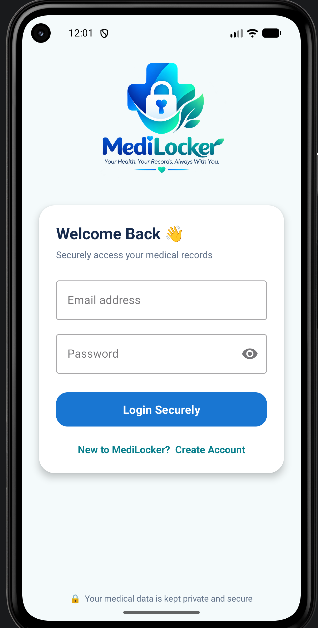
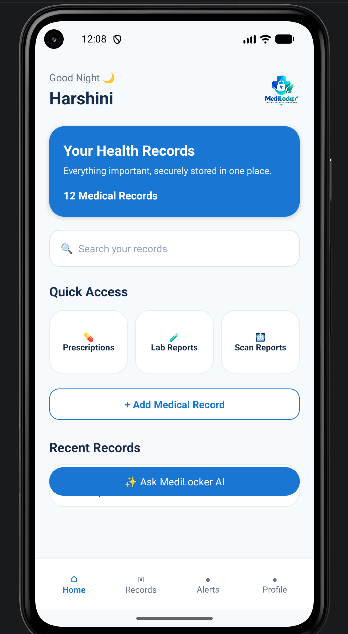
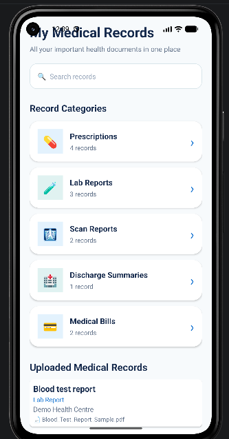
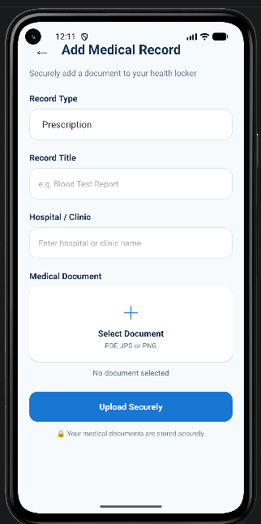
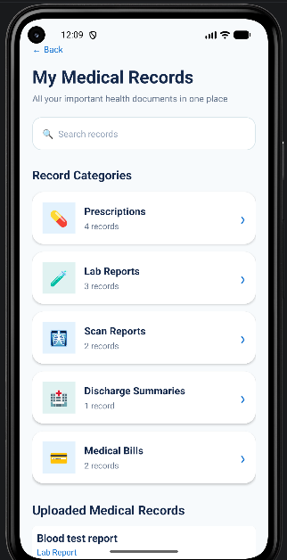
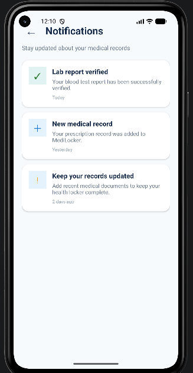
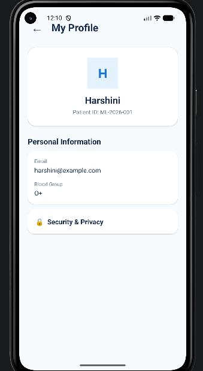
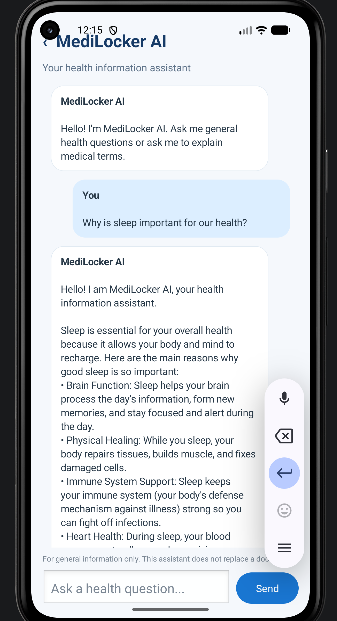

# MediLocker – AI-Powered Medical Record Management App

 

<p align="center">

  <b>Your Health. Your Records. Always With You.</b>

</p>

 

<p align="center">

  An Android application for organizing medical records with AI-powered health information assistance.

</p>

 

---

 

## 1. Project Overview

 

**MediLocker** is an AI-powered medical record management Android application developed to help users organize and access their medical documents in one place.

 

People often maintain medical documents in different physical files, folders, and digital locations. Finding a particular prescription, laboratory report, or scan report when needed can become difficult.

 

MediLocker addresses this problem by providing a centralized mobile application where users can select, organize, and access their medical documents.

 

The application also integrates a Gemini-powered AI chatbot through a Python Flask backend. It helps users understand common medical terminology and provides explanations of general health-related questions in simple language.

 

## 2. Project Objectives

 

The main objectives of MediLocker are:

 

- To provide a centralized platform for organizing medical records.

- To simplify the process of selecting and accessing medical documents.

- To categorize medical documents for easier management.

- To develop a user-friendly Android application.

- To integrate Artificial Intelligence for general health information assistance.

- To provide simple explanations of common medical terminology through an AI chatbot.

 

## 3. Key Features

 

### 3.1 User Login

- Provides a login interface for accessing the application.

- Offers a simple and user-friendly interface.

 

### 3.2 Dashboard

- Provides an overview of the application.

- Helps users navigate between different sections.

- Provides access to medical records and other features.

 

### 3.3 Medical Record Management

- Allows users to organize medical documents.

- Provides a dedicated section for viewing available records.

- Helps users access their selected medical documents.

 

### 3.4 Upload Medical Records

- Allows users to select documents from their device.

- Uses the Android document picker for selecting files.

- Supports organizing uploaded records through categories.

 

### 3.5 Record Categories

 

Medical documents are organized into the following categories:

 

| Category | Description |

|---|---|

| Prescriptions | Medical prescriptions |

| Laboratory Reports | Blood tests and other laboratory reports |

| Scan Reports | Medical scan documents |

| Discharge Summaries | Hospital discharge documents |

| Medical Bills | Medical and hospital bills |

 

### 3.6 Alerts

- Provides a dedicated alerts screen.

- Offers an interface for displaying relevant alerts.

 

### 3.7 User Profile

- Provides a profile section.

- Displays user profile information.

 

### 3.8 MediLocker AI Chatbot

- Integrates the Google Gemini API.

- Uses a Python Flask backend for AI communication.

- Explains common medical terms in simple language.

- Answers general health-related questions.

- Provides an interactive chat interface.

 

---

 

## 4. Technologies Used

 

| Technology | Purpose |

|---|---|

| Kotlin | Android application development |

| XML | Designing Android user interfaces |

| Android Studio | Android development environment |

| Python | Backend development |

| Flask | Backend API development |

| Google Gemini API | AI chatbot integration |

| SharedPreferences | Local storage of application metadata |

| JSON | Storing and processing record metadata |

| python-dotenv | Managing backend environment variables |

| HTTP Requests | Communication between Android and Flask backend |

 

---

 

## 5. System Architecture

 

MediLocker follows a client-server architecture for its AI chatbot functionality.

 

### Architecture Components

 

**1. Android Application**

- Developed using Kotlin and XML.

- Provides the user interface.

- Allows users to select and manage medical documents.

- Stores record metadata locally using SharedPreferences and JSON.

 

**2. Flask Backend**

- Developed using Python and Flask.

- Receives chatbot requests from the Android application.

- Communicates with the Gemini API.

- Sends the generated response back to the Android application.

 

**3. Google Gemini API**

- Processes general health-related questions.

- Generates explanations of medical terms.

- Provides responses that are displayed in the chatbot interface.

 

### Data Flow

 

```text

       USER

         |

         v

  ANDROID APPLICATION

     (Kotlin + XML)

         |

         |

         v

    AI CHAT REQUEST

         |

         v

    FLASK BACKEND

       (Python)

         |

         v

   GOOGLE GEMINI API

         |

         v

   GENERATED RESPONSE

         |

         v

    FLASK BACKEND

         |

         v

  ANDROID APPLICATION

         |

         v

   DISPLAY AI RESPONSE

```

 

---

 

## 6. Project Structure

 

The Android application and Python backend are maintained as separate project components.

 

### Android Project

 

```text

MediLocker/

│

├── app/

│   ├── src/

│   │   └── main/

│   │       ├── java/

│   │       │   └── com/example/medilocker/

│   │       │

│   │       ├── res/

│   │       │   ├── drawable/

│   │       │   ├── layout/

│   │       │   ├── mipmap/

│   │       │   └── values/

│   │       │

│   │       └── AndroidManifest.xml

│   │

│   └── build.gradle.kts

│

├── gradle/

├── build.gradle.kts

├── settings.gradle.kts

├── gradlew

├── gradlew.bat

└── README.md

```

 

### Python Backend Project

 

```text

MediLockerAI/

│

├── app.py

├── .env

└── requirements.txt

```

 

*Note: The structure above is a documentation overview. Actual filenames and folders may differ depending on your implementation.*

 

---

 

## 7. Application Screenshots

 

The following screenshots demonstrate the main application interfaces.

 

### 7.1 Login Screen

 

The login screen provides the initial interface for accessing MediLocker.

 



 

### 7.2 Dashboard

 

The dashboard provides navigation to the main application features.

 



 

### 7.3 Medical Records

 

The records screen provides access to the user's organized medical documents.

 



 

### 7.4 Upload Medical Record

 

Users can select medical documents from their device.

 



 

### 7.5 Record Categories

 

Medical records are organized into different categories.

 



 

### 7.6 Alerts

 

The alerts screen provides an interface for displaying alerts.

 



 

### 7.7 User Profile

 

The profile screen displays user-related information.

 



 

### 7.8 AI Chatbot

 

The AI chatbot allows users to ask general health-related questions and understand common medical terms.

 



 

---

 

## 8. Installation and Setup

 

### 8.1 Prerequisites

 

Before running the project, ensure that the following software and tools are available:

 

- Android Studio

- Android SDK

- Kotlin support

- Python 3

- Flask

- Google Gemini API key

- Android Emulator or Android device

 

### 8.2 Clone the Repository

 

Open a terminal and execute:

 

```bash

git clone https://github.com/harshinimk13/MediLocker-.git

```

 

Navigate to the project directory:

 

```bash

cd MediLocker-

```

 

### 8.3 Open the Android Project

 

1. Open Android Studio.

2. Select **Open**.

3. Choose the cloned MediLocker project folder.

4. Allow Gradle synchronization to complete.

5. Connect an Android device or start an emulator.

6. Run the application.

 

---

 

## 9. Backend Configuration

 

The AI chatbot uses a separate Python Flask backend.

 

### Step 1: Navigate to the Backend Folder

 

```bash

cd MediLockerAI

```

 

### Step 2: Install Dependencies

 

```bash

pip install flask google-genai python-dotenv

```

 

### Step 3: Configure the Gemini API Key

 

Create a `.env` file in the backend directory.

 

Add your API key:

 

```env

GEMINI_API_KEY
```

 

Replace `your_api_key_here` with your actual Gemini API key.

 

**Important:** Never upload your `.env` file or expose your API key on GitHub.

 

### Step 4: Start the Flask Server

 

Run the following command:

 

```bash

python app.py

```

 

The Flask backend should now be running on its configured local address and port.

 

### Step 5: Configure Android Emulator Communication

 

For communication between the Android Emulator and the Flask server running on the development computer, use:

 

```text

http://10.0.2.2:5000/chat

```

 

**Important:** `10.0.2.2` is the special address used by the Android Emulator to access the development computer's localhost.

 

Keep the Flask server running while testing the AI chatbot.

 

---

 

## 10. Local Data Storage

 

MediLocker uses Android SharedPreferences and JSON to maintain medical record metadata locally.

 

### Storage Approach

 

- SharedPreferences is used for local application data.

- JSON is used to represent and process medical record metadata.

- Record information is maintained on the device.

- Selected document references are used by the application to access the corresponding files.

 

### Benefits

 

- Simple local data management.

- No separate database server is required for the current metadata-storage implementation.

- Supports organizing medical records within the application.

 

**Current implementation note:** This project uses local storage for record metadata. It does not currently implement a cloud-based medical document storage service.

 

---

 

## 11. Testing

 

The following areas can be tested to verify the application's functionality.

 

| Test Case | Expected Result |

|---|---|

| Open the application | Login screen should appear |

| Access the dashboard | Dashboard should be displayed |

| Open medical records | Records screen should appear |

| Select a medical document | Document picker should open |

| Select a record category | Appropriate category should be available |

| Open the alerts screen | Alerts interface should appear |

| Open the profile screen | Profile information should be displayed |

| Open AI Chat | Chat interface should appear |

| Send a chatbot question | Backend should process the request and return a response |

| Stop the Flask server | AI communication should fail until the backend is available again |

 

---

 

## 12. Future Enhancements

 

The following features can be considered for future development:

 

- Cloud-based medical document storage.

- Secure authentication and authorization.

- Improved document search and filtering.

- Medical appointment reminders.

- Document backup and synchronization.

- AI-powered medical document summarization.

- Improved medical record classification.

- Enhanced privacy and data protection mechanisms.

 

---

 

## 13. Limitations

 

- Medical record metadata is currently stored locally.

- AI chatbot functionality requires an active Flask backend.

- AI responses depend on the availability of the Gemini API.

- The application requires an internet connection for AI chatbot communication.

- Cloud synchronization and centralized document backup are not part of the current implementation.

 

---

 

## 14. Disclaimer

 

MediLocker is an educational project developed to demonstrate Android application development, local medical record management, backend integration, and AI chatbot functionality.

 

The AI chatbot provides general health information and explanations of medical terminology. It is not intended to provide medical diagnosis, treatment recommendations, or emergency medical assistance.

 

Users should consult qualified healthcare professionals for medical advice.

 
 

---

 


 

<p align="center">

  <b>MediLocker – Your Health. Your Records. Always With You.</b>

</p>
